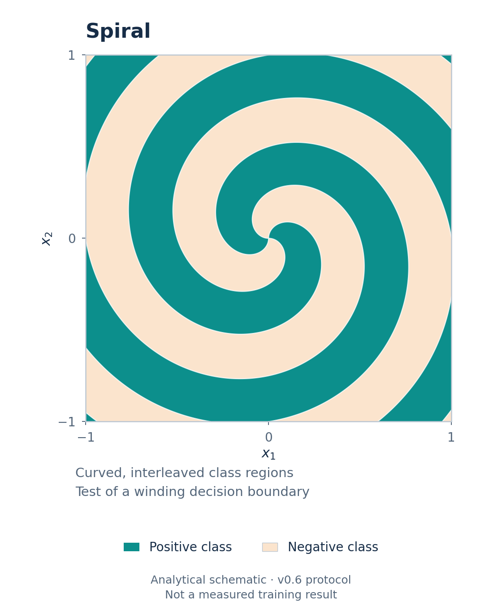
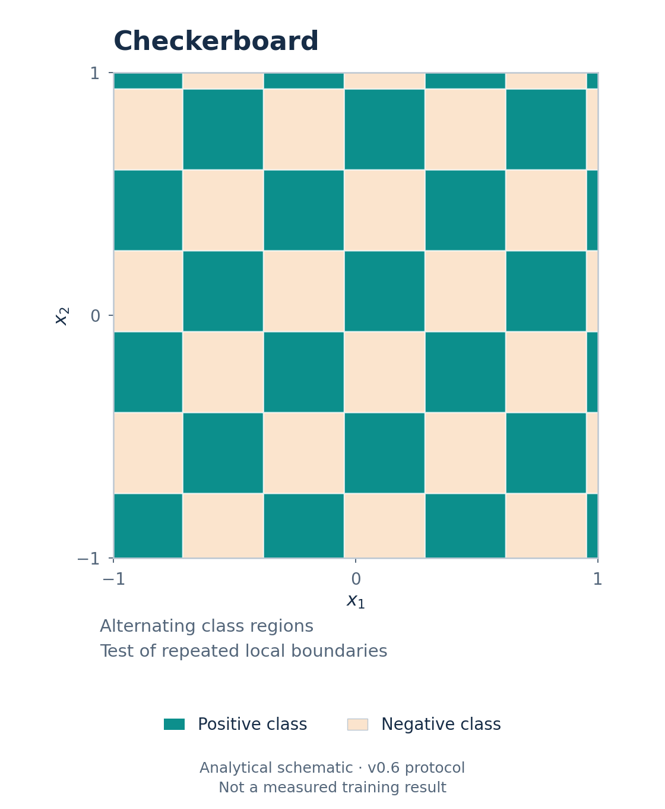
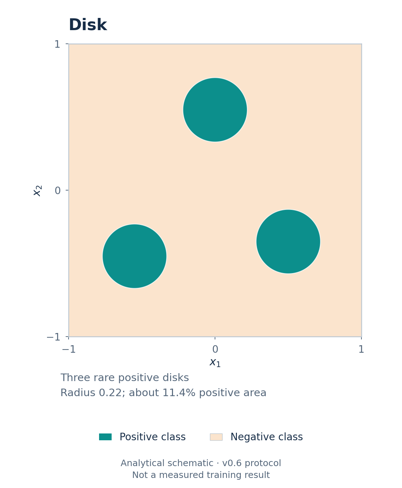
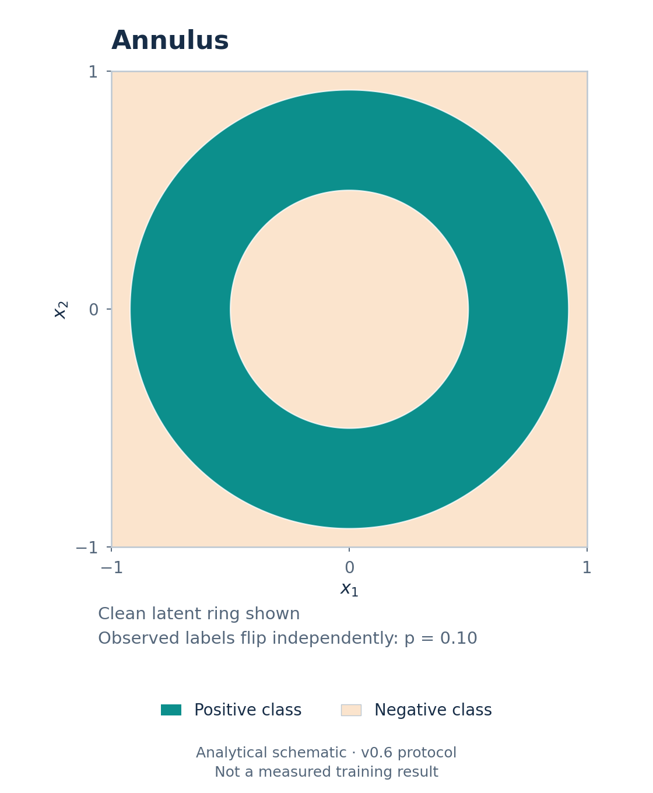
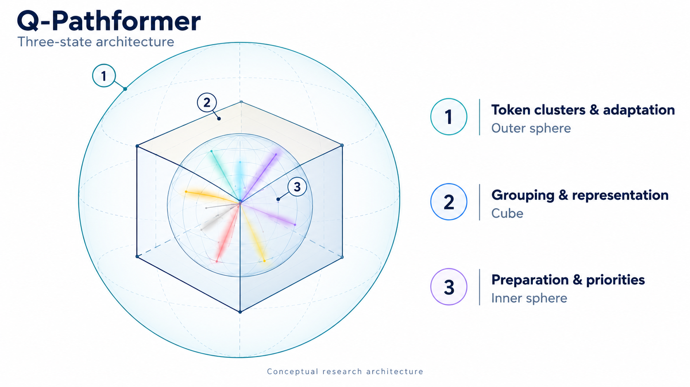

# Q-Pathformer Classical Research v1.0

**Routed learning, classical baselines and quantum circuit simulation.**

Q-Pathformer investigates how learning systems choose where to spend their effort: which examples receive training, which specialist models contribute to a prediction, and which training jobs receive more computation.

This research collection brings together completed component studies, the main findings paper and a separate specification for the proposed three-state architecture. It connects an architectural idea with experiments that examine its mechanisms, preserving improvements, adverse comparisons and inconclusive results.

The aim is to make architectural ideas testable. Comparisons examine whether a result comes from useful routing, additional model flexibility, different information or a larger resource budget. Strong classical controls and numerical reference implementations help identify what a circuit-based approach contributes under the tested conditions.

## Start reading

| Read | What it helps you understand |
| --- | --- |
| **[Q-Pathformer Routed States: Classical Models and Quantum Circuit Simulation](docs/papers/QPathformer_Main_Paper_v1.0.pdf)** | Completed findings on circuit readouts, routing, classical inference conversion and training allocation, centred on studies v0.6, v0.9 and v0.9.5. |
| **[Q-Pathformer Three-State Architecture and Experimental Specification](docs/papers/QPathformer_Architecture_and_Experimental_Specification_v1.0.pdf)** | The proposed system, experimental controls and decisions to settle before future integrated runs. |
| **[Research Approach](docs/RESEARCH_APPROACH.md)** | The research questions, comparison method, contribution opportunities and future research cycle. |

[Collection reading guide](docs/COLLECTION_GUIDE.md) · [Main paper in Word](docs/papers/QPathformer_Main_Paper_v1.0.docx) · [Architecture companion in Word](docs/papers/QPathformer_Architecture_and_Experimental_Specification_v1.0.docx)

## What the studies show

- **Richer readouts and routing can help on selected tasks.** Their value depends on the task and comparison. Strong classical controls remain better in important cases.
- **Selected trained circuit predictors support equivalent classical inference.** Conversion preserves their predictions within the reported numerical checks and improves local inference time under the measured conditions.
- **Execution and training allocation require separate evaluation.** The tested ETEL suitability policy did not establish its registered practical quality gain. Capped successive halving used less mean CPU across the four tested tasks.
- **Component evidence guides the next experiments.** These studies report classical computation and quantum-circuit simulation. The results do not establish physical-QPU performance, quantum advantage or validation of the full integrated architecture.

The studies use different tasks, populations, controls and budgets. Read each result within its protocol; the version sequence records the development of the research questions. The [main paper](docs/papers/QPathformer_Main_Paper_v1.0.pdf) explains the comparisons and their limits.

## Choose a download

The **[Research v1.0 consolidated release](https://github.com/qpathformer/qpathformer-classical-research-v1.0/releases/tag/research-v1.0-20261031)** is the main download entry. Choose one ZIP and its matching seal; Consolidated already contains Papers.

| Package | Best starting point | Integrity record |
| --- | --- | --- |
| **[Papers ZIP](https://github.com/qpathformer/qpathformer-classical-research-v1.0/releases/download/research-v1.0-20261031/QPathformer_All_Papers_v1.0.zip)** | Main paper, architecture companion, ten supporting study reports and preserved original architecture, with reading and rights indexes. | [Papers seal](https://github.com/qpathformer/qpathformer-classical-research-v1.0/releases/download/research-v1.0-20261031/QPathformer_All_Papers_v1.0.seal.json) |
| **[Consolidated ZIP](https://github.com/qpathformer/qpathformer-classical-research-v1.0/releases/download/research-v1.0-20261031/QPathformer_Consolidated_Release_v1.0.zip)** | Papers together with the separate Research Approach, repository guidance and the identified release source snapshot. | [Consolidated seal](https://github.com/qpathformer/qpathformer-classical-research-v1.0/releases/download/research-v1.0-20261031/QPathformer_Consolidated_Release_v1.0.seal.json) |

Extract the chosen ZIP and open `README.md` for Papers or `START_HERE.md` for Consolidated. Research Approach is included in Consolidated at `repository/docs/RESEARCH_APPROACH.md`. The [delivery receipt](https://github.com/qpathformer/qpathformer-classical-research-v1.0/releases/download/research-v1.0-20261031/QPathformer_Research_v1.0_Delivery_Receipt.json) and seals support file-integrity checks; they are not digital signatures or evidence of a scientific result.

Both papers include bookmarks and page labels. If a PDF reader blocks a companion link, open the adjacent PDF directly. GitHub's automatic **Source code** archives contain the tagged repository tree; the curated ZIPs provide the paper collection and its reading guides. Later repository guidance updates are identified in [edition status](docs/EDITION_STATUS.md).

Individual study releases retain three complementary downloads:

| Part | Purpose |
| --- | --- |
| **Study** | Report, methods, findings and limitations. |
| **Documentation** | Guidance, provenance and reproduction boundaries. |
| **Code** | Selected implementation and package-specific startup instructions. |

The collection does not introduce a unified implementation of the proposed architecture. Use the relevant study's Code package and follow its own startup and reproduction instructions.

## What has been built

The programme has produced training and evaluation software, circuit and classical-model implementations, routing and readout components, equivalent classical inference implementations for selected predictors, and records supporting the reported comparisons. Individual study releases provide selected source code and guidance. Trained checkpoints, datasets and full experiment archives remain separately retained where the study specifies.

Later work includes **Q-Path Multiplier - Elastic Task Execution Layer (ETEL) v0.1**. ETEL coordinates bounded tasks and workers, records execution state for recovery and accounts for resources. Its execution role is distinct from the policy that allocates training budget. The v0.9.5 Code package includes the selected ETEL core and execution adapter.

**ETEL v0.1 is a component version. Study v0.1 is the initial experiment series and has no ETEL component.** Research edition v1.0 identifies this collection. Historical source identifiers are recorded in [naming and attribution](NOTICE.md).

## Four illustrative tasks

The later studies use small two-dimensional classification tasks to make routing and decision boundaries inspectable. These illustrations show analytic task regions introduced in v0.6; they are not fitted model predictions.

| Spiral | Checkerboard |
|:---:|:---:|
|  |  |
| Curved, interleaved boundaries. | Repeated changes between neighbouring regions. |

| Rare disks | Noisy annulus |
|:---:|:---:|
|  |  |
| Small positive regions among many negatives. | The latent ring before independent 10% observed-label flips. |

[Task definitions and model guide](docs/RESEARCH_GUIDE.md) · [Illustration sources](assets/ILLUSTRATIONS.md)

## Release index

The [consolidated Research v1.0 release](https://github.com/qpathformer/qpathformer-classical-research-v1.0/releases/tag/research-v1.0-20261031) is the main entry. The studies below follow from newest to earliest; this is a navigation order, not a performance ranking. Each study preserves its own Study, Documentation and Code assets.

| Release | Main question |
| --- | --- |
| **[Research v1.0](https://github.com/qpathformer/qpathformer-classical-research-v1.0/releases/tag/research-v1.0-20261031)** | Main findings paper, three-state architecture companion and consolidated research collection. |
| [v0.9.5](https://github.com/qpathformer/qpathformer-classical-research-v1.0/releases/tag/study-v0.9.5) | Training-budget allocation with ETEL suitability, fixed allocation and successive halving. |
| [v0.9](https://github.com/qpathformer/qpathformer-classical-research-v1.0/releases/tag/study-v0.9) | Learned routing and global classical controls. |
| [v0.8](https://github.com/qpathformer/qpathformer-classical-research-v1.0/releases/tag/study-v0.8) | Training-example priority. |
| [v0.7](https://github.com/qpathformer/qpathformer-classical-research-v1.0/releases/tag/study-v0.7) | Routing capacity, population replication and deployment. |
| [v0.6](https://github.com/qpathformer/qpathformer-classical-research-v1.0/releases/tag/study-v0.6) | Harder task families and equivalent classical inference. |
| [v0.5](https://github.com/qpathformer/qpathformer-classical-research-v1.0/releases/tag/study-v0.5) | More flexible output recipes and classical controls. |
| [v0.4](https://github.com/qpathformer/qpathformer-classical-research-v1.0/releases/tag/study-v0.4) | Routing effects versus predictor effects. |
| [v0.3](https://github.com/qpathformer/qpathformer-classical-research-v1.0/releases/tag/study-v0.3) | Spatial routing for shallow circuits. |
| [v0.2](https://github.com/qpathformer/qpathformer-classical-research-v1.0/releases/tag/study-v0.2) | Revised schedules and stronger baseline comparisons. |
| [v0.1](https://github.com/qpathformer/qpathformer-classical-research-v1.0/releases/tag/study-v0.1) | Initial circuit schedules, text routing and local QPU-readiness checks. |

## Reproduce and contribute

Start with the relevant Code package's quickstart. A passed startup check shows that selected commands ran in the recorded environment; it does not reproduce the study. Full reproduction needs the separately retained frozen artifacts and a compatible environment. Storage figures describe retained evidence and should be read separately from model size or hardware requirements.

Useful contributions include independent reproductions, corrections, stronger controls, numerical checks, clearer resource measurements and well-documented negative findings. See [Contributing](CONTRIBUTING.md), [reproduction boundaries](docs/REPRODUCIBILITY.md) and [artifact contents and rights](ARTIFACT_RIGHTS.md).

## Where the research goes next

The next questions concern routing beyond the present task families, training priorities, adaptation and retention, execution recovery, and allocation policies measured against simple controls. Each requires a declared protocol and evidence appropriate to its claim.

A first physical-QPU pilot is a separate proposed experiment. It would evaluate a frozen, classically trained predictor against saved references, using a qualified current device and a declared measurement budget. Hardware inference and hardware training are separate milestones. See the [research direction](docs/RESEARCH_ROADMAP.md) and [QPU preparation plan](docs/QPU_RELEASE_PLAN.md).

The illustration connects preparation and priorities, grouped representations and routing, and token clusters and adaptation. The [architecture companion](docs/papers/QPathformer_Architecture_and_Experimental_Specification_v1.0.pdf) specifies the proposed model and future experiments. The [original QPATH-ARCH-001](docs/architecture/QPATH-ARCH-001.pdf) remains unchanged, with its [source and publication history](docs/architecture/README.md).

Reuse terms are identified in the [research rights guide](docs/RESEARCH_V1_RIGHTS.md) and the notices included with each package. [Trademark policy](TRADEMARKS.md) covers branding and endorsement separately.

**Anthony Siljeg — Founder, Alnotrea Labs · Company affiliation: Alnotrea Pty Ltd · Q-Pathformer Initiative.**

[Q-Pathformer research programme](https://github.com/qpathformer) · [Research Approach](docs/RESEARCH_APPROACH.md)
